 

 

 <strong>⬢ LOCAL-FIRST · ⬢ DECENTRALIZED · ⬢ PRIVACY-FIRST · ⬢ SOVEREIGN</strong>

---

 
 

  
  &nbsp;&nbsp;&nbsp;
  
  &nbsp;&nbsp;&nbsp;
  

 
 

<!-- Frameworks -->

<strong>FRAMEWORKS</strong>

  
  
  
  
  
  
  
  
  

<!-- Frontend -->

<strong>FRONTEND</strong>

  
  
  
  
  
  

<!-- Backend & bases de données -->

<strong>BACKEND &amp; DATA</strong>

  
  
  
  
  

<!-- IA locale -->

<strong>LOCAL AI</strong>

  
  
  
  
  
  

<!-- Web3 -->

<strong>WEB3</strong>

  
  
  

<!-- Self-hosted & sécurité -->

<strong>SELF-HOSTED &amp; SECURITY</strong>

  
  
  
  
  
  
  
  
  
  
  

<!-- Outils -->

<strong>TOOLS</strong>

  
  
  
  

 

 
 

 <picture>
   <source media="(prefers-color-scheme: dark)" srcset="https://raw.githubusercontent.com/Paarroo/Paarroo/output/contribution-fx-dark.svg">
   <source media="(prefers-color-scheme: light)" srcset="https://raw.githubusercontent.com/Paarroo/Paarroo/output/contribution-fx.svg">
   
 </picture>

